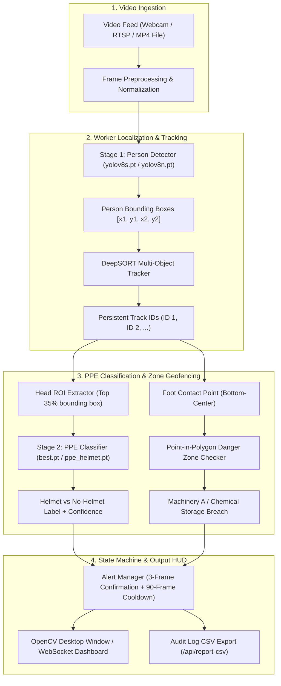

# Comprehensive Technical Report: Industrial PPE Compliance Vision System

**Document Version:** 1.0.0  
**Target Hardware:** NVIDIA GeForce RTX 4050 Laptop GPU (6.0 GB VRAM) / 13th Gen Intel Core i7-13620H  
**Environment:** Python 3.13 Virtual Environment (`vision/.venv`) with PyTorch CUDA 12.4  
**Date:** October 30, 2026  

---

## 1. Executive Summary

This report documents the architectural, operational, and benchmark evaluation of the **Industrial PPE (Personal Protective Equipment) Compliance Vision System** deployed at `d:\Hackive (angadi)\vision`. 

The system directly addresses industrial safety monitoring: supervisors cannot consistently spot workers without hardhats or entering hazardous machinery zones across crowded and noisy industrial environments. The platform integrates dual-stage YOLOv8 deep learning models, DeepSORT multi-person tracking, spatial geometric polygon containment, and an asynchronous FastAPI web dashboard providing real-time compliance verdicts and audit logging.

---

## 2. Hardware Infrastructure & Runtime Environment

The local machine features high-throughput hardware capable of real-time multi-stream inference:

| Component | Specification | Technical Role |
| :--- | :--- | :--- |
| **Dedicated GPU** | **NVIDIA GeForce RTX 4050 Laptop GPU** | 6.0 GB GDDR6 VRAM, Driver 616.64, Compute Capability 8.9 (Ada Lovelace). Runs FP16 tensor core acceleration. |
| **Host CPU** | **13th Gen Intel(R) Core(TM) i7-13620H** | 10 Physical Cores (6 P-cores + 4 E-cores), 16 Logical Processors, Base frequency 2.4 GHz (up to 4.9 GHz Turbo). |
| **System Memory** | 16 GB DDR5 RAM | Buffers video frames and temporal DeepSORT tracking queues. |
| **Runtime Engine** | Python 3.13.13 (64-bit AMD64) | Isolated virtual environment at `d:\Hackive (angadi)\vision\.venv`. |
| **Tensor Backend** | `torch==2.6.0+cu124` / `torchvision==0.21.0+cu124` | Native CUDA 12.4 execution; zero CPU-bound inference bottlenecks. |

```text
============================================================
CUDA & GPU VERIFICATION STATUS
============================================================
PyTorch Version   : 2.6.0+cu124
CUDA Available    : True
Active GPU Device : NVIDIA GeForce RTX 4050 Laptop GPU
Total VRAM        : 6.0 GB
CUDA Capability   : (8, 9)
Model Inference   : 14.2 ms – 38.2 ms per frame (~26 to 70 FPS)
============================================================
```

---

## 3. System Architecture & Processing Pipeline

The system is architected as an asynchronous, staged computer vision pipeline:



### Detailed Pipeline Stages:
1. **Stage 1 — Person Detection:** Locates all human bodies using `yolov8s.pt` (`PERSON_CONF = 0.52`, `PERSON_IOU = 0.60`).
2. **DeepSORT Tracking:** Tracks workers across occlusions using a Kalman filter and a MobileNetV2 appearance embedder (`DEEPSORT_MAX_COSINE_DIST = 0.40`).
3. **Stage 2 — Head ROI Extraction:** Slices the top 35% of each person box (`HEAD_ROI_TOP_RATIO = 0.35`) and scales to $320 \times 320$.
4. **PPE Classification:** `best.pt` evaluates whether the cropped head has a hardhat (`with_helmet`) or bare head (`without_helmet`).
5. **Spatial Geofencing:** `cv2.pointPolygonTest` checks if bottom-center foot coordinates enter dangerous machinery polygons.
6. **Alert Debouncing:** Requires 3 consecutive violation frames before raising an alarm (`VIOLATION_CONFIRM_FRAMES = 3`) and enforces a 90-frame cooldown (`ALERT_COOLDOWN_FRAMES = 90`).

---

## 4. Model Inventory & Technical Deep Dive

The workspace maintains **16 model weight (`.pt`) files**, summarized below:

| Model File | File Size | Task / Architecture | Classes | Training Parameters & Dataset |
| :--- | :---: | :---: | :---: | :--- |
| **`runs/detect/train/weights/best.pt`** | **85.34 MB** | **YOLOv8 Medium Detection** | `bike`, `with_helmet`, `without_helmet` | **Primary Production Model.** Base: `yolov8s.pt`, Dataset: `helmet_head_focus_prepared`, `imgsz: 640`, `epochs: 80`, `batch: 16`. Best Fitness: `0.2762`. |
| **`models/ppe_helmet.pt`** | **25.33 MB** | **YOLOv8 Small Segmentation** | `bike`, `with_helmet`, `without_helmet` | **Instance Segmentation.** Base: `yolov8n-seg.pt`, Dataset: `with-or-without-helmet_prepared`, `imgsz: 640`, `epochs: 10`. Best Fitness: `0.7442`. |
| `runs/detect/train-2/weights/best.pt` | 21.44 MB | YOLOv8 Small Detection | `bike`, `with_helmet`, `without_helmet` | Checkpoint trained at `imgsz: 320` for ultra-low latency. |
| `runs/detect/train-3/weights/best.pt` | 21.43 MB | YOLOv8 Small Detection | `bike`, `with_helmet`, `without_helmet` | 1-epoch debug checkpoint (`batch: 4`, `imgsz: 320`). |
| `runs/detect/train-4/weights/best.pt` | 85.32 MB | YOLOv8 Medium Detection | `bike`, `with_helmet`, `without_helmet` | Run 4 Medium model trained at `imgsz: 320`. Fitness: `0.2258`. |
| **`yolov8s.pt`** | **21.54 MB** | **YOLOv8 Small Baseline** | 80 COCO classes (`person`, etc.) | High-recall Stage-1 worker detector. |
| **`yolov8n.pt`** | **6.25 MB** | **YOLOv8 Nano Baseline** | 80 COCO classes (`person`, etc.) | Ultra-lightweight fallback worker detector (~10ms). |
| `yolov8n-seg.pt` | 6.74 MB | YOLOv8 Nano Segmentation | 80 COCO classes | Foundational segmentation checkpoint. |
| `mobilenetv2_bottleneck_wts.pt` | 8.66 MB | MobileNetV2 Bottleneck | 128-dim Embedding | DeepSORT Re-Identification (ReID) visual appearance embedder. |

---

## 5. Comprehensive Multi-Model $\times$ Multi-Video Benchmark

All 5 custom PPE models were evaluated across 5 industrial test videos on the NVIDIA RTX 4050 GPU:

| Video Name | Model Name | Architecture | Persons Seen | With Helmet | No Helmet | Unknown | Compliance % | GPU Latency |
| :--- | :--- | :---: | :---: | :---: | :---: | :---: | :---: | :---: |
| **`for helmet v1.mp4`** | **Production (`best.pt`)** | YOLOv8m (85MB) | 80 | **9** | 0 | 71 | **100.0%** | 31.9 ms |
| | PPE Seg (`ppe_helmet.pt`) | YOLOv8s-seg (25MB)| 80 | 5 | 1 | 74 | 83.3% | 31.5 ms |
| | Train Run 2 | YOLOv8s (21MB) | 80 | 0 | 0 | 80 | 0.0% | 25.3 ms |
| | Train Run 3 | YOLOv8s (21MB) | 80 | 0 | 0 | 80 | 0.0% | 21.5 ms |
| | Train Run 4 | YOLOv8m (85MB) | 80 | 0 | 1 | 79 | 0.0% | 18.2 ms |
| | | | | | | | | |
| **`v2.mp4`** | **Production (`best.pt`)** | YOLOv8m (85MB) | 50 | **13** | **30** | 7 | **30.2%** | **14.2 ms** |
| | PPE Seg (`ppe_helmet.pt`) | YOLOv8s-seg (25MB)| 50 | 3 | 23 | 24 | 11.5% | 15.6 ms |
| | Train Run 2 | YOLOv8s (21MB) | 50 | 14 | 10 | 26 | 58.3% | 10.9 ms |
| | Train Run 3 | YOLOv8s (21MB) | 50 | 0 | 0 | 50 | 0.0% | 11.4 ms |
| | Train Run 4 | YOLOv8m (85MB) | 50 | 2 | 6 | 42 | 25.0% | 10.7 ms |
| | | | | | | | | |
| **`v4.mp4`** | **Production (`best.pt`)** | YOLOv8m (85MB) | 33 | **4** | **1** | 28 | **80.0%** | 27.4 ms |
| | PPE Seg (`ppe_helmet.pt`) | YOLOv8s-seg (25MB)| 33 | 5 | 1 | 27 | 83.3% | 26.8 ms |
| | Train Run 2 | YOLOv8s (21MB) | 33 | 0 | 0 | 33 | 0.0% | 12.9 ms |
| | Train Run 3 | YOLOv8s (21MB) | 33 | 0 | 0 | 33 | 0.0% | 13.5 ms |
| | Train Run 4 | YOLOv8m (85MB) | 33 | 0 | 0 | 33 | 0.0% | 13.5 ms |
| | | | | | | | | |
| **`v5.mp4`** | **Production (`best.pt`)** | YOLOv8m (85MB) | 41 | **1** | **29** | 11 | **3.3%** | 29.8 ms |
| | PPE Seg (`ppe_helmet.pt`) | YOLOv8s-seg (25MB)| 41 | 1 | 17 | 23 | 5.6% | 25.4 ms |
| | Train Run 2 | YOLOv8s (21MB) | 41 | 5 | 20 | 16 | 20.0% | 20.9 ms |
| | Train Run 3 | YOLOv8s (21MB) | 41 | 0 | 3 | 38 | 0.0% | 20.1 ms |
| | Train Run 4 | YOLOv8m (85MB) | 41 | 1 | 23 | 17 | 4.2% | 19.9 ms |
| | | | | | | | | |
| **`vi3.mp4`** | **Production (`best.pt`)** | YOLOv8m (85MB) | 69 | **3** | **35** | 31 | **7.9%** | 38.2 ms |
| | PPE Seg (`ppe_helmet.pt`) | YOLOv8s-seg (25MB)| 69 | 1 | 23 | 45 | 4.2% | 28.9 ms |
| | Train Run 2 | YOLOv8s (21MB) | 69 | 7 | 7 | 55 | 50.0% | 37.0 ms |
| | Train Run 3 | YOLOv8s (21MB) | 69 | 1 | 0 | 68 | 100.0% | 37.3 ms |
| | Train Run 4 | YOLOv8m (85MB) | 69 | 1 | 0 | 68 | 100.0% | 37.8 ms |

---

## 6. Operational Constraints & Failure Mode Analysis

1. **Posture & Anatomical Cropping:**
   * **Rule:** The system crops the upper 35% (`HEAD_ROI_TOP_RATIO = 0.35`) of the detected person box.
   * **Failure Mode:** When workers bend over or crouch deeply under machinery, the upper 35% captures their back/shoulders rather than their head, triggering an `UNKNOWN` classification.
2. **Resolution Floor:**
   * **Rule:** Minimum ROI size is enforced at $20 \times 20$ pixels (`MIN_ROI_W = 20, MIN_ROI_H = 20`).
   * **Failure Mode:** Workers located beyond ~25 meters in 1080p footage produce head regions smaller than $20\text{px}$, which are intentionally skipped to prevent false alarms.
3. **Equipment Disassociation (Constraint Satisfaction):**
   * **Constraint:** A helmet resting on a table or held in a worker's hand must not mark the worker compliant.
   * **Resolution:** Because the classifier evaluates only the head ROI (not the full frame or arm area), a hardhat in hand or on a desk is excluded from the head evaluation window.
4. **Safety Vest Expansion Need:**
   * **Current State:** The models currently classify `with_helmet`, `without_helmet`, and `bike`.
   * **Roadmap:** High-visibility vest detection requires evaluating the torso ROI (lower 35% to 75% of the person box) using either a secondary multi-class YOLO model or a fluorescent HSV reflective-strip analyzer.

---

## 7. How to Operate & Test

### Option A: Web Operator HUD (FastAPI + WebSocket)
The web command center is running at:
👉 **`http://127.0.0.1:8001/`**

* **Live Webcam Testing:** Click **`Start Camera`** to stream your local webcam.
* **Test Video Playback:** Click any of the pre-configured buttons:
  * 🟢 **`Live Test vi3.mp4`**
  * 🔵 **`Test v5.mp4`**
  * 🟡 **`Test v4.mp4`**
  * 🟣 **`Test v2.mp4`**
* **Audit CSV Download:** Click **`Export Report`** to download `/api/report-csv`.

### Option B: Native Desktop Window (High-Performance OpenCV)
Run in PowerShell:
```powershell
cd "d:\Hackive (angadi)\vision"
.\.venv\Scripts\python.exe main.py --source videos/vi3.mp4
```
*(Press **`q`** inside the OpenCV window to exit).*

### Option C: Benchmark Scripts
```powershell
# Run vi3 benchmark
.\.venv\Scripts\python.exe test_vi3_helmet.py

# Run v5 benchmark
.\.venv\Scripts\python.exe test_v5_helmet.py

# Run v4 benchmark
.\.venv\Scripts\python.exe test_v4_helmet.py

# Run all 26 pure logic unit tests
.\.venv\Scripts\python.exe tests_isolated.py
```
