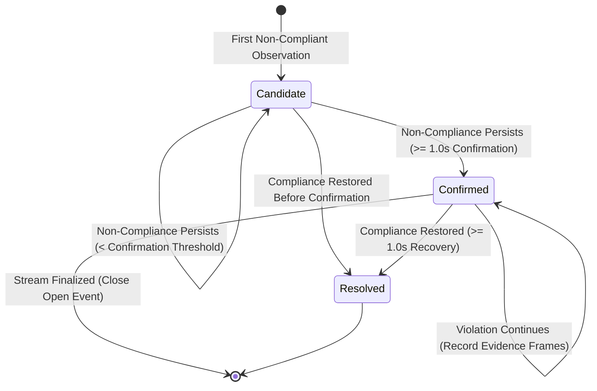

# SafeOps Safety Policy Compliance and Violation Event Rules

**Document Version**: 1.0.0  
**Repository**: `D:\Projects\SafeOps\Video Processing and ByteTrack\SafeOps_phase3`  

---

## 1. Safety Policy Configuration (`SafetyPolicyConfig`)

Safety compliance rules are defined independently from deep-learning model inference. Policies are configurable per site, zone, or inspection job:

```python
class SafetyPolicyConfig(BaseModel):
    policy_name: str = "Standard Industrial Safety Policy"
    require_helmet: bool = True               # Mandatory helmet verification
    require_vest: bool = False                # False when vest model is unavailable
    min_observations_for_decision: int = 15   # Minimum valid frames (~0.5s at 30 FPS)
    violation_confirmation_seconds: float = 1.0  # Duration non-compliance must persist
    recovery_confirmation_seconds: float = 1.0   # Duration compliance must persist to resolve
```

---

## 2. Four-State Compliance Logic

For every tracked worker in every frame, SafeOps evaluates compliance across four distinct states:

| Compliance State | Evaluation Criterion | Visual Badge Color |
| :--- | :--- | :--- |
| `COMPLIANT` | $> 50\%$ of valid observations in the temporal window confirm required PPE. | **Green** |
| `NON_COMPLIANT` | $> 50\%$ of valid observations in the temporal window confirm absence of required PPE. | **Red** |
| `INSUFFICIENT_EVIDENCE` | Worker recently entered the scene ($< \text{min\_observations}$ frames) or view is too brief to confirm. | **Orange** |
| `UNKNOWN` | Mandatory PPE detector model is uninstalled/unavailable (e.g. vest model absent). | **Gray** |

### Safety Principle: Evidence of Absence vs Absence of Evidence
- A missed helmet detection in 1 or 2 frames is treated as transient noise, **not** an immediate safety violation.
- If a worker has only been visible for 3 frames, the system abstains (`INSUFFICIENT_EVIDENCE`) until sufficient observations are gathered.
- When an inspection policy requires a vest but no vest model exists, SafeOps marks the state as `UNKNOWN`, refusing to fabricate false non-compliance.

---

## 3. Violation Event Lifecycle (`ViolationManager`)



### 3.1 Event Structure
```json
{
  "event_id": "VIOL-72E080BF",
  "track_id": 1,
  "violation_type": "missing_helmet",
  "start_timestamp": 0.467,
  "end_timestamp": 1.967,
  "status": "confirmed",
  "evidence_frames": [43, 44, 45, 46, 47, 48, 49, 50],
  "confidence": 1.0,
  "summary": "Worker 1 confirmed missing helmet"
}
```

### 3.2 Event Deduplication Guarantee
- Consecutive frames of an ongoing violation update the `end_timestamp` and append to `evidence_frames` of the existing `event_id`.
- The system never floods databases or API consumers with a new violation object on every frame.
- Exactly one event is created per violation episode.

