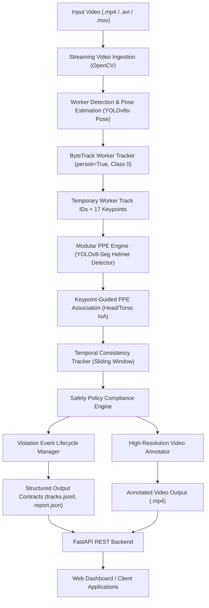

# SafeOps System Architecture Document

**System Version**: 1.0.0  
**Target Hardware**: NVIDIA GeForce RTX 3050 6GB Laptop GPU  
**Environment**: Windows 11, CUDA 12.4, PyTorch 2.6.0 (`.venv-gpu`)  

---

## 1. System Overview

SafeOps is an AI-powered industrial computer vision monitoring system designed to process CCTV video feeds, track workers, associate personal protective equipment (PPE), evaluate safety policies, generate confirmed violation events, and produce structured data reports and annotated videos.

### Logical Architecture Flowchart



---

## 2. Core Subsystems

### 2.1 Video Ingestion Subsystem (`src/video/video_stream.py`)
- **Memory-Efficient Streaming**: Frames are yielded sequentially via Python generators without buffering entire videos into system RAM.
- **Error Resilience**: Validates container headers, catches decompression corruption, and handles missing FPS metadata via fallback defaults.
- **Resource Management**: Uses `@contextmanager` to guarantee `cap.release()` on normal termination or unhandled exceptions.

### 2.2 Worker Detection & Tracking Subsystem (`src/tracking/worker_tracker.py`)
- **YOLOv8s-Pose Execution**: Runs inference on COCO class `0` (person only) in FP16 on CUDA.
- **Keypoint Extraction**: Derives 17 body landmarks and confidences for spatial geometry.
- **ByteTrack Integration**: Employs two-stage association (`track_high_thresh: 0.25`, `track_low_thresh: 0.10`) with `persist=True`.
- **Continuity State & Overlap Detection**: Detects spatial trajectory overlaps ($\text{IoU} \ge 0.35$) and flags `TrackingContinuityState.UNCERTAIN` to prevent invalid identity permanence assumptions.

### 2.3 Modular PPE Detection Engine (`src/ppe/detector.py`)
- **Abstract Detector Interface**: `BasePPEDetector` decouples model inference from association.
- **YOLOv8HelmetDetector**: Wraps custom segmentation weights (`models/ppe_helmet.pt`), isolating class `with_helmet`.
- **Pluggable Vest Interface**: Explicitly handles absent vest models by returning `status: "unknown"` with reason `"vest_model_not_installed"`, never fabricating vest predictions.

### 2.4 Geometric PPE-to-Worker Association (`src/association/ppe_association.py`)
- **Head Region**: Upper-facial landmarks (nose 0, eyes 1-2, ears 3-4) padded upward ($0.18 \times h$). Fallback: top 25% of worker bbox.
- **Torso Region**: Shoulder landmarks (5-6) and hips (11-12) padded outward. Fallback: 15% to 65% of worker height.
- **One-to-One Matching**: Evaluates Intersection over Area ($\text{IoA} = \frac{\text{Inter}}{\text{Area}(\text{PPE})}$). Greedy bipartite matching assigns each PPE box to at most one worker.
- **Primary Key**: Indexed strictly by `w["track_id"]`, eliminating list ordering sensitivity.

### 2.5 Temporal Consistency & Compliance Engine (`src/compliance/`)
- **Observation History (`temporal_state.py`)**: Sliding queue of recent frames (default 2.0s window).
- **Transient Noise Elimination**: Brief occlusions or turned heads (1-3 frames) do not trigger non-compliance.
- **Policy Decoupling (`compliance_engine.py`)**: Evaluates `SafetyPolicyConfig` (e.g. `require_helmet: true`, `require_vest: false`).
- **Violation Lifecycle (`violation_manager.py`)**:
  - `CANDIDATE`: Non-compliance observed.
  - `CONFIRMED`: Non-compliance persists $\ge 1.0\text{s}$.
  - `RESOLVED`: Compliance restored $\ge 1.0\text{s}$.
  - Deduplication: Single unique event per violation episode.

### 2.6 REST API & Asynchronous Services (`src/api/`)
- **FastAPI Engine**: Fully async REST endpoints with OpenAPI documentation.
- **Job Manager**: Single-worker background thread executor protecting 6GB VRAM from concurrency spikes.
- **Media Streaming**: Serves annotated MP4 videos via chunked `FileResponse`.

---

## 3. Data Flow and Schema Traceability

Every record produced by the pipeline maintains complete source traceability:

```
[Input Video]
      |
      v
VideoMetadata (video_id, filename, fps, width, height, duration)
      |
      v
WorkerTrackingRecord (frame_number, timestamp_seconds, track_id, bbox_xyxy, keypoints_xy, ppe, compliance)
      |
      +---> tracks.jsonl (line-delimited JSON stream)
      |
      v
ViolationEvent (event_id, track_id, violation_type, start_t, end_t, status, evidence_frames)
      |
      v
VideoAnalysisReport (metadata, policy, summary, workers[], violations[])
```

